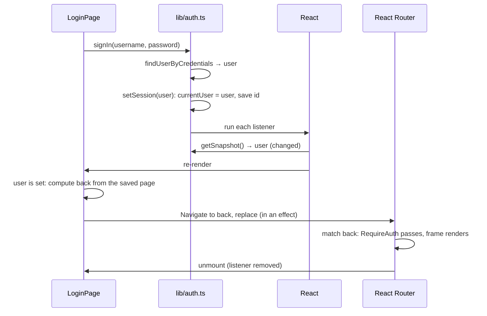

# Authentication and app access: a walkthrough

An onboarding guide to how the shell signs users in and decides which remotes each of them may open. It follows the code in the order it runs, so it is best read with the files open next to it. Every file named here is under `apps/shell/src/`, unless its path says otherwise.

**Contents**

1. [The big picture](#1-the-big-picture)
2. [The files involved](#2-the-files-involved)
3. [Users and grants](#3-users-and-grants)
4. [The app registry](#4-the-app-registry)
5. [The session store](#5-the-session-store)
6. [The routes](#6-the-routes)
7. [Step by step: a first visit](#7-step-by-step-a-first-visit)
8. [Step by step: signing in](#8-step-by-step-signing-in)
9. [Step by step: opening a remote](#9-step-by-step-opening-a-remote)
10. [Step by step: reloading and signing out](#10-step-by-step-reloading-and-signing-out)
11. [What this is not](#11-what-this-is-not)
12. [Recipes](#12-recipes)
13. [Common problems](#13-common-problems)

For the shorter runtime summary, see [how-it-works.md section 4.5](how-it-works.md#45-login-and-app-access). For setup, see the [README](../README.md).

---

## 1. The big picture

- **The shell owns everything about auth.** It signs the user in, keeps the session and decides which remotes may mount.
- **The remotes know nothing about it.** The `mount(el, { basePath })` contract carries no user. A remote can't tell who is signed in, and doesn't need to.
- **Two questions, two guards.**
  - "Is anyone signed in?" is answered by `RequireAuth`. It guards every route except `/login`.
  - "May this user open this remote?" is answered by `RequireApp`. It guards each remote's route.
- **One access rule.** Every access decision (the guards, the menu, the home page, the redirect after sign-in) goes through `canAccess`. Nothing else tests grants.
- **No backend.** The accounts are mock data from an env variable, inlined into the shell's bundle. The design keeps that stand-in behind one file, so a real identity provider can replace it there (see [section 11](#11-what-this-is-not)).

---

## 2. The files involved

| File                         | Role                                                                                              |
| ---------------------------- | ------------------------------------------------------------------------------------------------- |
| `apps/shell/.env.example`    | The format of the mock accounts, and a starting set to copy to `apps/shell/.env.local`.           |
| `env.d.ts`                   | Types the `VITE_MOCK_ACCOUNTS` variable.                                                          |
| `lib/users.ts`               | The stand-in identity provider: reads and validates the mock accounts, credential and id lookups. |
| `lib/access.ts`              | The grant types and `canAccess`, the one access rule.                                             |
| `lib/navigation.ts`          | The app registry (`NAV_ITEMS`) plus `getAccessibleItems` and `canOpenPath`.                       |
| `lib/auth.ts`                | The session store: `signIn`, `signOut`, `useSession`.                                             |
| `components/RequireAuth.tsx` | Guard: no user, redirect to `/login`.                                                             |
| `components/RequireApp.tsx`  | Guard: no access to this remote, render the "no access" page.                                     |
| `pages/LoginPage.tsx`        | The sign-in form, and the redirect back once signed in.                                           |
| `App.tsx`                    | The route tree that places the two guards.                                                        |

The order below goes from data (users, grants, apps) to state (the session) to UI (routes, guards, pages).

---

## 3. Users and grants

### `lib/users.ts`

A `User` is what the rest of the shell sees: an `id`, a display `name` and a list of `grants`. Internally, each mock account also has a username and a plain-text password. Those never leave the file: `toUser` strips them before returning.

The accounts are not in the code. They come from `VITE_MOCK_ACCOUNTS`, a JSON array set in `apps/shell/.env.local`:

- `.env.local` is git-ignored, so each developer keeps their own accounts out of the repo. `apps/shell/.env.example` documents the format and holds a starting set to copy.
- Vite exposes `VITE_*` variables to browser code as `import.meta.env.VITE_*` and **inlines their values into the bundle at build time**. The accounts stay out of git, not out of the browser.
- The value is parsed and validated the first time a lookup runs (`getAccounts`), not when the module is imported. A missing or invalid value makes the lookup throw a message saying what is wrong; the login page shows it, and the rest of the shell keeps working.
- Validation rejects an unknown `tech` or app id. Without it, a typo would give a grant that matches nothing, and the user would silently see no apps.

Two lookups are exported:

- `findUserByCredentials(username, password)`, used at sign-in;
- `findUserById(id)`, used to restore a session after a reload.

**Only `lib/auth.ts` calls them.** That rule is what makes the mock replaceable: swap these calls for a request to a real server, and nothing else changes.

### `lib/access.ts`

A grant says what a user may open. There are three kinds:

| Grant                    | Allows                                                  |
| ------------------------ | ------------------------------------------------------- |
| `{ kind: 'all' }`        | Every app.                                              |
| `{ kind: 'tech', tech }` | Every app built with that framework (`vue` or `react`). |
| `{ kind: 'apps', apps }` | The listed app ids.                                     |

A user holds a **list** of grants, and grants **combine**: the user may open an app if _any_ grant allows it. So "every React app plus one named Vue app" is two grants.

`canAccess(grants, app)` implements exactly that with `grants.some(...)`. It takes the app's `id` and `tech`, both of which come from the registry.

---

## 4. The app registry

### `lib/navigation.ts`

`NAV_ITEMS` lists every remote the shell can open. Each entry has an `id` (an `AppId`), a `tech`, and the base path `to` where its route lives. It feeds the sidebar menu, and it is also the registry the access rules check: a grant names apps by `id` or `tech`, and this is where those values are looked up.

Two helpers build on `canAccess`:

- **`getAccessibleItems(user)`** returns the entries the user may open, or none when signed out. The sidebar and the home page render only this list, so a user never sees a link they can't follow.
- **`canOpenPath(user, pathname)`** answers "may this user open this URL?" It finds the registry entry whose base path matches the URL. If one matches, the user needs access to it. If none matches, the URL is one of the shell's own pages (such as `/`), which every signed-in user may open. The login page uses it after sign-in ([section 8](#8-step-by-step-signing-in)).

---

## 5. The session store

### `lib/auth.ts`

This is the heart of the mechanism. It keeps "who is signed in" in a plain module variable, outside React, and lets components subscribe to it. It is built the same way as the theme store (`lib/theme.ts`).

It has four parts:

| Part               | What it is                                                                                                 |
| ------------------ | ---------------------------------------------------------------------------------------------------------- |
| `currentUser`      | The value: the signed-in `User`, or `null`.                                                                |
| `listeners`        | A `Set` of callbacks to run when the value changes.                                                        |
| `setSession(user)` | The only writer. Sets `currentUser`, saves or clears the id in `sessionStorage`, then runs every listener. |
| `useSession()`     | The hook components call to read the value and re-render when it changes.                                  |

#### Startup: restoring the session

```ts
let currentUser: User | null = restoreSession()
```

This line runs once, when the module is first imported, **before React renders anything**. `restoreSession` reads the user id from `sessionStorage` (key `SESSION_STORAGE_KEY`) and looks the user up again with `findUserById`. So:

- the first render already knows whether someone is signed in. There is no loading state and no flash of the login page;
- only the id is stored, never the user's grants. The grants are looked up fresh on every load, so a change to an account's grants applies on the next reload;
- if the id no longer matches an account, storage is blocked, or the accounts are missing or invalid, the user starts signed out.

`sessionStorage` is scoped to the browser tab: a reload keeps the session, closing the tab ends it.

#### Writing: `signIn` and `signOut`

```ts
export async function signIn(
  username: string,
  password: string,
): Promise<User> {
  const user = findUserByCredentials(username, password)
  if (!user) throw new Error('…')
  setSession(user)
  return user
}

export function signOut() {
  setSession(null)
}
```

`signIn` is `async` on purpose. The mock answers instantly, but a real sign-in is a network request, so callers already handle a promise and a rejection. Replacing the mock won't change them.

Both functions end in `setSession`, which does three things in order: update `currentUser`, update `sessionStorage`, and run every listener.

#### Reading: `useSession` and `useSyncExternalStore`

```ts
export function useSession(): User | null {
  return useSyncExternalStore(subscribe, () => currentUser)
}
```

React can't see a plain variable change by itself, so it has to be told. `useSyncExternalStore` is React's built-in hook for exactly this case: reading a value that lives outside React. It takes two functions:

1. **`subscribe`** registers a listener. When a component that calls `useSession` mounts, React calls `subscribe` with a callback of its own, and that callback is added to `listeners`. `subscribe` returns a function that removes it again; React calls that function when the component unmounts.
2. **`getSnapshot`** reads the current value. In the code it is the inline arrow `() => currentUser`, so you won't find the name `getSnapshot` anywhere; that is just the name React's documentation gives the second argument. React calls it on every render.

Put together, a change works like a doorbell:

1. `setSession` changes `currentUser`.
2. `setSession` runs every listener. A listener carries no data; it only tells React "this store may have changed."
3. React calls `getSnapshot` for each subscribed component and compares the result with the previous one (`Object.is`).
4. Every component whose value changed re-renders with the new user.

`getSnapshot` must return the same value for as long as the store hasn't changed, otherwise React would re-render forever. `currentUser` only gets a new object inside `setSession`, so this holds.

Why not `useState`? State in one component can't be shared with others, and `signIn` (plain module code, not a component) couldn't update it. The module store gives every component the same value, and any code can change it.

---

## 6. The routes

### `App.tsx`

The route tree places the guards:

```
/login                    LoginPage (outside the frame, no guard)
<RequireAuth>             guard for everything below
  <AppFrame>              header, menu, user menu
    /                     HomePage
    <remote base>/*       <RequireApp id> → the remote's host
    <remote base>/*       <RequireApp id> → the remote's host
    …
```

- `/login` sits **outside** `RequireAuth`. This matters: it means `RequireAuth` never runs on the login page, so it can never redirect the login page to itself.
- `RequireAuth` wraps a layout route, so it guards the frame and every page inside it with one element.
- Each remote's splat route is wrapped in its own `RequireApp`, with that remote's `AppId`.

### `components/RequireAuth.tsx`

```tsx
const user = useSession()
const location = useLocation()

if (!user) return <Navigate to="/login" replace state={{ from: location }} />
return children
```

With no user, it redirects to `/login` and attaches the current location as `from` in the navigation state. `from` is **the page the user tried to open**, not the browser's previous page. `replace` swaps the current history entry instead of adding one, so Back doesn't land on a page that would just redirect again.

### `components/RequireApp.tsx`

```tsx
const user = useSession()
const app = NAV_ITEMS.find((item) => item.id === id)

if (!user || !app || !canAccess(user.grants, app)) return <ForbiddenPage />
return children
```

It looks the remote up in the registry and asks `canAccess`. Without access it renders the "no access" page **instead of** its children, so the remote's host component never renders.

---

## 7. Step by step: a first visit

A user opens `http://localhost:5173/` in a fresh tab.

1. `main.tsx` imports `App`, which (through the guards) imports `lib/auth.ts`. `restoreSession` runs, finds no id in `sessionStorage`, and sets `currentUser = null`.
2. React renders. React Router matches `/`, which is inside the `RequireAuth` layout route.
3. `RequireAuth` calls `useSession()`. React subscribes it to the store and reads `null`.
4. `RequireAuth` renders `<Navigate to="/login" replace state={{ from: location }} />`, where `location.pathname` is `/`.
5. `Navigate` renders nothing. After the render is committed, it calls React Router's `navigate` in an effect. The URL becomes `/login`, replacing `/` in the history.
6. React Router matches `/login` and renders `LoginPage`. `RequireAuth` and the frame unmount; React removes their listeners from the store.
7. `LoginPage` calls `useSession()` (subscribing it), reads `null`, and shows the form.

A deep link works the same way: opening a remote's URL while signed out stores that URL as `from`.

---

## 8. Step by step: signing in



1. The user submits the form. `handleSubmit` reads the fields and calls `await signIn(username, password)`.
2. **Wrong credentials:** `signIn` throws, the page catches it and shows the message. Nothing else changes.
3. **Right credentials:** `signIn` calls `setSession(user)`. `currentUser` becomes the user, the id goes into `sessionStorage`, and the listeners run.
4. The login page's listener makes React call `getSnapshot`. It returns the user instead of `null`, so `LoginPage` re-renders.
5. This time `useSession()` returns a user, so `LoginPage` takes its `if (user)` branch and works out where to go:
   ```ts
   const from = (location.state as { from?: Location } | null)?.from
   const back =
     from && canOpenPath(user, from.pathname)
       ? `${from.pathname}${from.search}${from.hash}`
       : '/'
   ```
   - `from` is the page `RequireAuth` blocked in [section 7](#7-step-by-step-a-first-visit). It is never `/login`: `/login` is outside `RequireAuth`, so nothing ever stores it as `from`.
   - If the user opened `/login` directly, there is no state, `from` is `undefined`, and `back` is `/`.
   - `canOpenPath` checks the new user may open `from`. It may be a remote the previous user could open and this one can't ([section 10](#10-step-by-step-reloading-and-signing-out)). In that case `back` is `/`.
6. `LoginPage` returns `<Navigate to={back} replace />`. As in step 5 of the first visit, the navigation happens in an effect after the render. `replace` swaps `/login` out of the history, so Back doesn't return to the form.
7. React Router matches `back`. `RequireAuth` now reads a user and renders the frame. `LoginPage` no longer matches, so it unmounts and its listener is removed.

---

## 9. Step by step: opening a remote

A signed-in user follows a link to a remote's base path.

1. The frame's menu shows only `getAccessibleItems(user)`, so the link exists only if the user has access. A typed or bookmarked URL can still reach a forbidden remote, which is why the route has its own guard.
2. React Router matches the remote's splat route. `RequireAuth` passes, since a user is set.
3. `RequireApp` finds the remote in `NAV_ITEMS` and calls `canAccess(user.grants, app)`.
4. **With access**, it renders the remote's host. The host lazy-loads the remote's `mount` module and mounts it ([how-it-works.md section 4.2](how-it-works.md#42-navigating-to-todo-app)).
5. **Without access**, it renders the "no access" page. The host never renders, so the remote's `mount` module and app code are never downloaded.

Note that the federation runtime still fetches every remote's `remoteEntry.js` when the page starts, whoever is signed in. Only the app code is held back.

---

## 10. Step by step: reloading and signing out

### Reload

The page reloads, every module runs again, and `restoreSession` finds the stored id. It looks the user up with `findUserById`, so `currentUser` is set **before the first render**. `RequireAuth` passes straight away and the user stays on the same URL.

### Sign out

1. The user menu calls `signOut()`, which calls `setSession(null)`: `currentUser` becomes `null`, the id is removed from `sessionStorage`, and the listeners run.
2. Every subscribed component re-renders with `null`. `RequireAuth` redirects to `/login`, with the **current** page as `from`.
3. The frame unmounts. A mounted remote unmounts with it, through its host's effect cleanup ([how-it-works.md section 4.4](how-it-works.md#44-leaving-todo-app)), so nothing from it stays on the page.
4. The next user who signs in in this tab carries that `from`. That is why the login page checks `canOpenPath` before sending them there: it may be the previous user's remote.

---

## 11. What this is not

- **Not security.** Everything happens in the browser. Anyone can read the mock accounts in the bundle, set a session id by hand, or fetch a remote's files straight from its server. The gating keeps honest users on the right pages; it protects nothing. Real enforcement needs the server: remote assets behind auth, or a per-user list of remotes served after sign-in.
- **Not a real identity provider.** Passwords are plain text in `VITE_MOCK_ACCOUNTS` and end up in the bundle. Use dev-only passwords.
- **Not shared with the remotes.** No remote can read the user. If a remote ever needs the user, pass it through the `mount` contract explicitly, and update `remotes/remotes.d.ts` with it.

### Replacing the mock

The seams are already in place:

- `signIn` becomes a request to the real server (or an IdP redirect). It is already `async`, so `LoginPage` doesn't change.
- `restoreSession` asks the server who is signed in (a session cookie or a token) instead of reading an id from `sessionStorage`.
- Each user's grants come from the server (claims or roles) and are mapped onto `AccessGrant`.
- `lib/users.ts` is deleted, along with `VITE_MOCK_ACCOUNTS` (`apps/shell/.env.example`, `env.d.ts`, the root `turbo.json`). Only `lib/auth.ts` imported `users.ts`, so nothing else changes.

---

## 12. Recipes

**Read the signed-in user in a shell component.** Call `useSession()`. It returns `User | null` and re-renders the component on sign-in and sign-out. Don't read `sessionStorage` directly.

**Check access in a shell component.** Call `canAccess(user.grants, app)`, or `getAccessibleItems` / `canOpenPath`, which wrap it. Never test `grant.kind` or a user id anywhere else: keeping the rule in one function is what keeps the menu, the home page and the guards consistent.

**Guard a new remote.** Follow "Adding another microfrontend" in the [README](../README.md). The auth part of it:

1. add an entry to `NAV_ITEMS` with a new `AppId` and the remote's `tech`;
2. wrap its route in `App.tsx` in `<RequireApp id="<its id>">`;
3. give the accounts that should see it a grant in `VITE_MOCK_ACCOUNTS`: in your `apps/shell/.env.local`, and in the starting set in `apps/shell/.env.example` so other developers get it too. A user with an `all` grant, or a `tech` grant for its framework, sees it without changes.

**Set up the accounts.** Copy `apps/shell/.env.example` to `apps/shell/.env.local`, then edit it. The JSON can span several lines inside the single quotes.

**Change who can open what.** Edit the accounts' `grants` in `apps/shell/.env.local`. Vite restarts the shell's dev server by itself when an env file changes; reload the page. Since only the id is stored in the session, the new grants apply to a signed-in user too.

---

## 13. Common problems

| Symptom                                                        | Cause                                                                                                                                                              |
| -------------------------------------------------------------- | ------------------------------------------------------------------------------------------------------------------------------------------------------------------ |
| After sign-in the user lands on `/`, not the page they opened  | The new user may not open that page (`canOpenPath` is false), or `/login` was opened directly, so there was no `from`.                                             |
| A new remote is missing from the menu for everyone             | Its `NAV_ITEMS` entry exists, but no grant covers it (`all`, its tech or its id).                                                                                  |
| A user sees a remote in the menu but gets the "no access" page | The route's `RequireApp id` doesn't match the `NAV_ITEMS` entry's `id`.                                                                                            |
| A component doesn't update after sign-in or sign-out           | It reads the session some other way than `useSession()` (a `sessionStorage` read, or a copy kept in `useState`), so it is never subscribed.                        |
| The user is signed out after closing and reopening the tab     | Expected: `sessionStorage` lives as long as the tab.                                                                                                               |
| A grant change doesn't apply                                   | Reload the page: grants are looked up when the session is restored, on load. Under `pnpm preview`, rebuild: the value is inlined at build time.                    |
| Sign-in says there are no accounts                             | `VITE_MOCK_ACCOUNTS` is unset: copy `apps/shell/.env.example` to `apps/shell/.env.local`, then reload. If the dev server doesn't pick up the new file, restart it. |
| Sign-in says an account is invalid                             | That entry (counted from 0) has a missing field, an unknown grant `kind` or `tech`, or an app id that isn't in `NAV_ITEMS`.                                        |
| Sign-in says the value is not valid JSON                       | Often a trailing comma, or an unescaped `'` inside the single-quoted value.                                                                                        |
