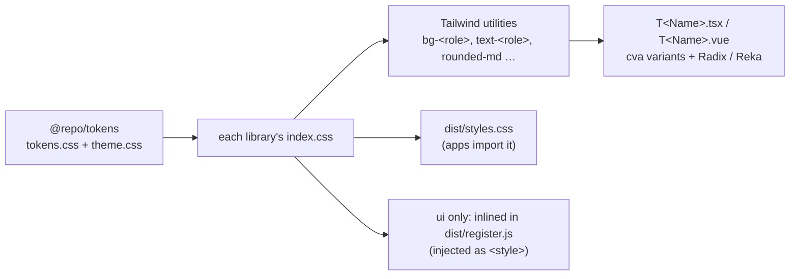

# The design system: tokens, Tailwind and `T` components

How the shared design tokens (`@repo/tokens`) become styled components in two native libraries, `@repo/ui` (React, Radix) and `@repo/ui-vue` (Vue, Reka UI), and how those components and their styles reach the apps. For the custom-element bridge the todo MFE still uses, see [react-components-in-vue.md](react-components-in-vue.md).

**Contents**
1. [Where it lives](#1-where-it-lives)
2. [The pipeline at a glance](#2-the-pipeline-at-a-glance)
3. [Design tokens](#3-design-tokens)
4. [The Tailwind layer](#4-the-tailwind-layer)
5. [The component recipe](#5-the-component-recipe) (React; [layout](#51-layout-components); [Vue](#52-the-vue-library))
6. [Naming conventions](#6-naming-conventions)
7. [One stylesheet, two deliveries](#7-one-stylesheet-two-deliveries)
8. [Adding a component](#8-adding-a-component)
9. [Things worth knowing](#9-things-worth-knowing)

For setup and commands, see the [README](../README.md).

---

## 1. Where it lives

Three packages ("Option B": two native libraries sharing the tokens; the reasoning is in [react-components-in-vue.md](react-components-in-vue.md#1-the-decision-one-library-bridged)):

```
packages/tokens/       @repo/tokens: CSS only, no build
  tokens.css           design tokens: plain CSS custom properties (--t-*)
  theme.css            the token → utility bridge (@theme inline), for every Tailwind build on the design system

packages/ui/src/       @repo/ui: React + Radix
  styles/index.css     the library stylesheet: Tailwind (no Preflight) + the tokens + the theme
  lib/cn.ts            class-name helper (clsx + tailwind-merge)
  lib/layout.ts        shared variants (gap, padding, alignment) and the style-merge helper of the layout components
  components/T<Name>/  one folder per component: T<Name>.tsx, T<Name>.variants.ts, types.ts, index.ts
  index.ts             entry ".":          the React components (and the stylesheet, for the build)
  register.ts          entry "./register": the stylesheet, injected + each component as a <t-*> custom element
  env.d.ts             Vite's types, for the .css and ?inline imports

packages/ui-vue/src/   @repo/ui-vue: the same components natively in Vue, on Reka UI
  styles/index.css     the same setup as ui's
  lib/cn.ts, layout.ts copies of ui's (the layout maps, plus written-out prop types)
  lib/attrs.ts         useRootAttrs(): merges the caller's class and style onto a component's root
  components/T<Name>/  T<Name>.vue (+ part SFCs), T<Name>.variants.ts (identical to ui's), types.ts, index.ts
  index.ts             entry ".": the Vue components (and the stylesheet, for the build)
```

Each component exists once per framework, and both implementations share the same class strings, so they look the same.

## 2. The pipeline at a glance



- Tokens are plain CSS variables. They work with or without Tailwind.
- Tailwind is the authoring tool *inside* each library. Its utilities resolve to the tokens.
- Components only ever use token-backed utilities, never raw colours.
- Each library builds one stylesheet; ui's is built into two forms, so React hosts and custom-element hosts both get it (see [section 7](#7-one-stylesheet-two-deliveries)).

## 3. Design tokens

### 3.1 Two tiers

| Tier | Naming | Example | Who uses it |
|---|---|---|---|
| 1. Primitive | `--t-<hue>-<step>` | `--t-iris-9` | Only tier 2. Components never reference a primitive. |
| 2. Semantic | `--t-color-<role>`, `--t-radius-*`, `--t-font-*`, `--t-shadow-*`, `--t-ease-*` | `--t-color-accent` | The Tailwind bridge, and therefore every component. |

The semantic roles fall into four groups:
- **surfaces and text**: the page canvas, raised surfaces, foreground, muted foreground, lines;
- **accent**: solid fill and its hover, the text colour on top of it, subtle fills, the accent line and accent text;
- **danger**: the same solid trio, in red;
- **focus**: the focus-ring colour.

A component asks for a *role* ("accent fill"), never a *colour* ("iris 9"). Swapping the brand colour is therefore a change to tier 2 only.

Tier 2 also holds **layout sizes** that Tailwind's scale has no step for: container widths (`--t-container-*`) and the app-level sidebar and header sizes (`--t-layout-*`). Components read them with Tailwind's variable shorthand (`max-w-(--t-container-md)`). They are deliberately not mapped into `@theme`: Tailwind's `--container-*` names also drive its `@container` breakpoints. Spacing and type sizes have no tokens. They use Tailwind's own scale, like every other component.

### 3.2 The palette and why

The colour scales are [Radix Colors](https://www.radix-ui.com/colors) (MIT), vendored as hex values into `tokens.css`:

| Scale | Role | Why |
|---|---|---|
| Iris | accent | A calm blue-violet that reads well both as a solid fill and as text. |
| Slate | neutrals | Radix's natural pairing for Iris: a cool grey with a hint of the same hue. |
| Red | danger | Built on the same 12-step model, so its steps line up with the other two. |

What makes the system work is that **every step has a fixed job**, the same in every scale and in both themes ([Radix: understanding the scale](https://www.radix-ui.com/colors/docs/palette-composition/understanding-the-scale)):

| Steps | Job |
|---|---|
| 1–2 | app and subtle backgrounds |
| 3–5 | component fills: normal, hover, pressed |
| 6–8 | borders and separators; 8 also serves as the focus ring |
| 9–10 | solid fills and their hover state |
| 11–12 | low- and high-contrast text |

The scales are tuned with the APCA contrast model: text on steps 11–12 over the step 1–2 backgrounds is designed to stay readable in both themes. Mapping each role to the step with the matching job keeps that guarantee. The type tokens are system font stacks. A web font would need its own delivery story across federation (see [section 9](#9-things-worth-knowing)).

### 3.3 Light and dark

- **Tier 1 switches.** Light values sit on `:root`, and dark values sit in `@media (prefers-color-scheme: dark)`.
- **Tier 2 mostly doesn't.** Because each step keeps its job in both themes, the semantic aliases stay the same. The only exception is the canvas: white in light mode, step 1 of the neutral in dark mode, as Radix recommends.
- `:root` sets `color-scheme: light dark`, so native parts (scrollbars, default form controls, the page's default canvas) follow too.

Components contain no `dark:` classes. They switch automatically because the tokens underneath them do.

### 3.4 Re-theming

Each library imports `@repo/tokens/tokens.css` into the `base` cascade layer. Any unlayered CSS beats layered CSS, so a host can re-theme without touching the packages:

```css
/* in a host's own stylesheet */
:root { --t-color-accent: #0d74ce; }
```

## 4. The Tailwind layer

Each library's `styles/index.css` is the only file its Tailwind compiles. The two are the same; in order, they do the following.

**Declares the layer order.**

```css
@layer theme, base, components, utilities;
```

**Imports Tailwind without Preflight.**

```css
@import 'tailwindcss/theme.css' layer(theme);
@import 'tailwindcss/utilities.css' layer(utilities) source('..');
```

- Preflight is Tailwind's CSS reset. It is deliberately left out: a component library must not reset the page it is loaded into, and the Vue MFE runs inside the shell's page. The price is that components reset the browser's defaults for their own elements (see [section 5](#5-the-component-recipe)).
- `source('..')` limits class scanning to the library's own `src` (`.tsx` in ui, `.vue` and `.ts` in ui-vue).

**Imports the tokens** (`@repo/tokens/tokens.css`) into `layer(base)` (see [section 3.4](#34-re-theming)).

**Bridges tokens to utilities** with `@theme inline`, from `@repo/tokens/theme.css`, so both libraries and any app running Tailwind use the same bridge (see [section 7](#7-one-stylesheet-two-deliveries)):

```css
@theme inline {
  --color-*: initial;                       /* drop Tailwind's default palette */
  --color-<role>: var(--t-color-<role>);    /* one line per semantic colour */
  --radius-md: var(--t-radius-md);          /* standard Tailwind names, token values */
  --font-sans: var(--t-font-sans);
}
```

- `--color-*: initial` removes every default colour, so `bg-<role>` exists and `bg-red-500` does not. Off-system colours fail visibly instead of slipping in.
- `inline` makes utilities emit `var(--t-…)` directly (`.bg-accent { background-color: var(--t-color-accent) }`), so they follow the tokens wherever those are redefined.
- Radius, font, shadow and easing keep Tailwind's standard names (`rounded-md`, `font-sans` and so on). `tailwind-merge` only knows the standard scales, so this is what lets it resolve conflicts without extra configuration.

**Applies the tokens to the page** in a small `base` rule for `body`: font, canvas background, foreground colour, font smoothing. This is the only page-level styling the library ships.

## 5. The component recipe

Each `T<Name>.tsx` in `@repo/ui` follows the same shape. The Vue library follows the same ideas in Vue form ([section 5.2](#52-the-vue-library)).

**Behaviour comes from Radix.** Radix Primitives has no Button primitive. For a component that is "an element plus styles", the recipe is a native element plus [Radix `Slot`](https://www.radix-ui.com/primitives/docs/utilities/slot):

```tsx
const Comp = asChild ? Slot : 'button'
```

- By default it renders the native element, so it gets native keyboard, form and accessibility behaviour.
- With `asChild`, `Slot` renders the caller's single child instead and merges the component's classes, handlers and ref onto it, for example to style a router link.

For components with real behaviour (dialogs, selects, tabs), the recipe wraps the matching Radix primitive package instead.

**Styles come from `cva`.**

```tsx
const tNameVariants = cva('<base classes>', {
  variants: { variant: { … }, size: { … } },
  defaultVariants: { … },
})
```

- `class-variance-authority` maps variant props to class strings, and `VariantProps<typeof tNameVariants>` turns them into typed props.
- The final class is `cn(tNameVariants({ … }), className)`. `cn` (`lib/cn.ts`) is `twMerge(clsx(…))`, so a caller's `className` wins conflicts instead of depending on stylesheet order.
- **Base classes reset browser defaults.** Without Preflight, a native button keeps its UA border, font and cursor unless the component sets them.
- **Disabled uses the native attribute**, not `pointer-events: none`. A natively disabled button dispatches no click at all. With `pointer-events: none` the click falls through to whatever is underneath. In Vue that is the `<t-*>` host element, whose inline box spans the middle of the button and where Vue's listener sits, so a disabled component would still fire. Hover styles are scoped with `not-disabled:` instead.
- **Text content also has a prop.** A custom element can't pass React children, so components that show text accept it as a prop, with `children` taking precedence in React.

### 5.1 Layout components

Layout components hold children, so they are never registered as custom elements: children can't cross the bridge (see [react-components-in-vue.md](react-components-in-vue.md#45-content)). Vue apps get them natively from `@repo/ui-vue`. They follow the same recipe in both libraries, with these additions.

- **Stateless.** Anything that collapses or switches sides is a prop (a modifier class) that the caller controls.
- **Intrinsic, not viewport-responsive.** A component can end up inside a microfrontend slot of unknown width, so it adapts to its *container*:
  - `flex-wrap` with a basis or min-width;
  - `repeat(auto-fit, minmax(min(100%, X), 1fr))`;
  - `min(100%, X)` wherever a fixed minimum could overflow a narrow container.

  No viewport breakpoints (`md:` and the like). The only exception is the page-level app frame, which uses one documented `max-md:` query, because it *is* the viewport.
- **Shared scales.** Gap, padding and alignment props use the maps in `lib/layout.ts`, where steps 0–8 cover Tailwind's 0–64px spacing. Defaults go in `cva`'s `defaultVariants`. A caller's `className` wins through `cn`, as usual.
- **Lengths from props** become CSS variables on the root when children or an expression use them, and plain inline styles otherwise. Either way they are merged into the caller's `style` (`withStyle`), never replace it.
- **Parts and root modifiers.** A component with parts exports them from the same folder. When the root has to restyle a part (order, width), the part carries a `data-slot` attribute and the root targets only its direct children (`[&>[data-slot=…]]:…`). That keeps nested instances independent and needs no React context.
- **`asChild` with internal structure.** When the component renders its own elements (a heading, a body wrapper) around the caller's content, use Radix `Slottable`:
  - `<Slottable>{children}</Slottable>` puts the slotted element's children at that position;
  - the render form `<Slottable child={children}>{(content) => …}</Slottable>` wraps them, so the content still lands inside the wrapper when the caller supplies the root element.
- **Headings** set their margin, size, weight and line-height explicitly, so the heading level a caller chooses never changes the look.

### 5.2 The Vue library

`@repo/ui-vue` has the same components, props and look as `@repo/ui`. What changes is the Vue form:

| Concern | React (`@repo/ui`) | Vue (`@repo/ui-vue`) |
|---|---|---|
| Element swap | Radix `Slot` behind `asChild` | Reka `Primitive`: `as` (an element or component) and `asChild` |
| Behaviour primitives | Radix (e.g. its label) | Reka UI, the Vue port of Radix |
| Content | `children`, and props for named areas | the default slot, and named slots for named areas |
| Caller's class | `cn(variants, className)` | `inheritAttrs: false` + `useRootAttrs()`, which runs the caller's `class` through the same `cn` |
| Inline lengths | merged into `style` (`withStyle`) | bound as `[vars, $attrs.style]` |
| Prop types | `VariantProps<typeof tNameVariants>` | written out in `types.ts`: `defineProps` can't derive runtime props from a computed type |
| Inputs | controlled `value` + `onChange` | `defineModel()`, so `v-model` works |
| Generated ids | — (one React root per app) | `useId()`, unique per app: each Vue app on the page sets its own `app.config.idPrefix` |
| Structure around content | `Slottable` keeps `asChild` working | `as` only: the root changes, the inner structure stays |

**The class strings are the contract.** Every `*.variants.ts`, and the maps in `lib/layout.ts`, are identical in both libraries; their built stylesheets contain the same utilities. Change a variant in both libraries, or they stop looking the same.

## 6. Naming conventions

| Thing | Pattern | Notes |
|---|---|---|
| Component | `T<Name>` | the public export of both libraries |
| Props type | `T<Name>Props` | exported as a type |
| Custom element | `<t-<name>>` | the kebab-case of `T<Name>`, defined in `register.ts` |
| Design tokens | `--t-*` | primitives `--t-<hue>-<step>`, semantics `--t-color-<role>` and so on |
| Injected stylesheet | `<style id="t-ui-styles">` | one per page (see [react-components-in-vue.md](react-components-in-vue.md#5-styles-across-the-boundary)) |

The Vue compiler treats every `t-*` tag as a custom element (`isCustomElement` in `apps/todo-mfe/vite.config.ts`), so the `t-` prefix is reserved for design-system elements in Vue templates.

## 7. One stylesheet, two deliveries

| Consumer | How it gets the CSS | Built by |
|---|---|---|
| React host (the shell) | `import '@repo/ui/styles.css'` once, in its entry | `index.ts` imports `styles/index.css`; Vite library mode extracts it to `dist/styles.css` (`build.lib.cssFileName: 'styles'`) and removes the import from the JavaScript. |
| Vue remote on `@repo/ui-vue` | its own `src/styles.css` imports `@repo/ui-vue/styles.css`; `mount.ts` imports that file with `?inline` and injects it as a `<style>` while mounted | ui-vue's `dist/styles.css`, built like ui's. Inlined because a federated remote can't count on its host or on federation to load a CSS file. |
| Custom-element host (the todo MFE) | nothing to do: `import '@repo/ui/register'` brings it | `register.ts` imports `styles/index.css?inline`, a string compiled by the same Tailwind plugin, and writes it into one `<style>` before defining any element. |

An app that runs **its own Tailwind** (the shell, the Vue docs remote) imports `@repo/tokens/theme.css` into its Tailwind stylesheet:
- its own utilities (`bg-surface`, `text-fg-muted`, …) then resolve to the same tokens, and off-system colours don't exist there either;
- it skips Preflight for the same reason the libraries do: microfrontends render inside the shell's page;
- it loads after the library stylesheet. Utilities that both builds generate are identical, so the duplicates are harmless.

`@repo/tokens` has no build: its files are input for each consumer's Tailwind, compiled into that consumer's CSS. Consumers list it as a devDependency, and each library's `turbo.json` lists it as a `build` input, so a token change invalidates their cached builds.

Why the custom-element path can't just use the CSS file is explained in [react-components-in-vue.md](react-components-in-vue.md#5-styles-across-the-boundary).

Build details:
- `@tailwindcss/vite` runs in each library's `vite.config.ts`. It compiles `.css` and `.css?inline` alike; it skips only `?raw`, `?url` and `?worker`.
- In `vite build --watch`, Tailwind registers every scanned source file as a watch dependency. A new class in a `.tsx` file therefore rebuilds both `dist/styles.css` and the string inside `dist/register.js`.
- `package.json` exports `./styles.css`, and lists `./dist/styles.css` in `sideEffects` so a bundler never drops the bare import.
- Tailwind is a **devDependency** of each library. The runtime helpers (`@radix-ui/*` or `reka-ui`, `class-variance-authority`, `clsx`, `tailwind-merge`) are `dependencies` and are kept external in the library build, so each app bundles them, like the framework itself.

## 8. Adding a component

1. **Tokens.** If the component needs a role that doesn't exist yet, add `--t-color-<role>` to tier 2 in `packages/tokens/tokens.css` (pointing at a primitive step with the right job), and its `--color-<role>` line to `@theme inline` in `packages/tokens/theme.css`.
2. **Component.** Create `src/components/T<Name>/` (`T<Name>.tsx`, `T<Name>.variants.ts`, `types.ts`, `index.ts`):
   - for behaviour, use a native element plus `Slot`, or the matching Radix primitive (install it as a ui `dependency` through the catalog);
   - write its variants with `cva`, using only token-backed utilities, and merge `className` through `cn`;
   - give any visible text a prop as well as `children`.
3. **Export it.** Add `T<Name>` and `T<Name>Props` to `src/index.ts`.
4. **Bridge it** (not for layout or other children-based components; see [section 5.1](#51-layout-components)). In `src/register.ts`, `define('t-<name>', r2wc(bridge(T<Name>), { props: { … } }))`. Declare every prop the custom element should accept, with its r2wc type. The bridge rules (booleans, events, content, compound components) are in [react-components-in-vue.md](react-components-in-vue.md#4-crossing-the-boundary).
5. **Vue counterpart.** Create `packages/ui-vue/src/components/T<Name>/` with the **same** `T<Name>.variants.ts`, a `types.ts` with the props written out, and `T<Name>.vue` following [section 5.2](#52-the-vue-library). Export it from ui-vue's `src/index.ts`.
6. **New runtime dependency?** Add it to `external` in that library's `vite.config.ts` as well.
7. **Check** `pnpm build` and `pnpm typecheck`, then look at the component in both docs pages, in both colour schemes.

## 9. Things worth knowing

- **Which classes exist depends on the host.** In an app that runs Tailwind with `@repo/tokens/theme.css` (the shell, the Vue docs remote), any utility works, in its own markup and in a class passed to a component. In an app that doesn't (the todo MFE), only classes used in the library's `src` exist, so a class in its own markup does nothing unless the library happens to use it.
- **The scanner reads words, not code.** Any word in `src` that happens to be a utility name produces that utility, for example a variant key that is also a utility name. This is harmless (a few unused rules) but explains surprises in `dist/styles.css`.
- **`transition-colors` includes `outline-color`.** A focus ring therefore fades in over the transition duration rather than appearing instantly.
- **Fonts are system stacks.** A web font would need its files served from somewhere both the shell and a federated remote can reach. `url()`s in the inlined CSS resolve against the *page*, not the remote. Decide the hosting before adding one.
- **Colours are sRGB hex.** Radix also publishes Display-P3 versions of each scale. Adding them is a tier-1-only change inside an `@supports (color: color(display-p3 1 1 1))` block.
