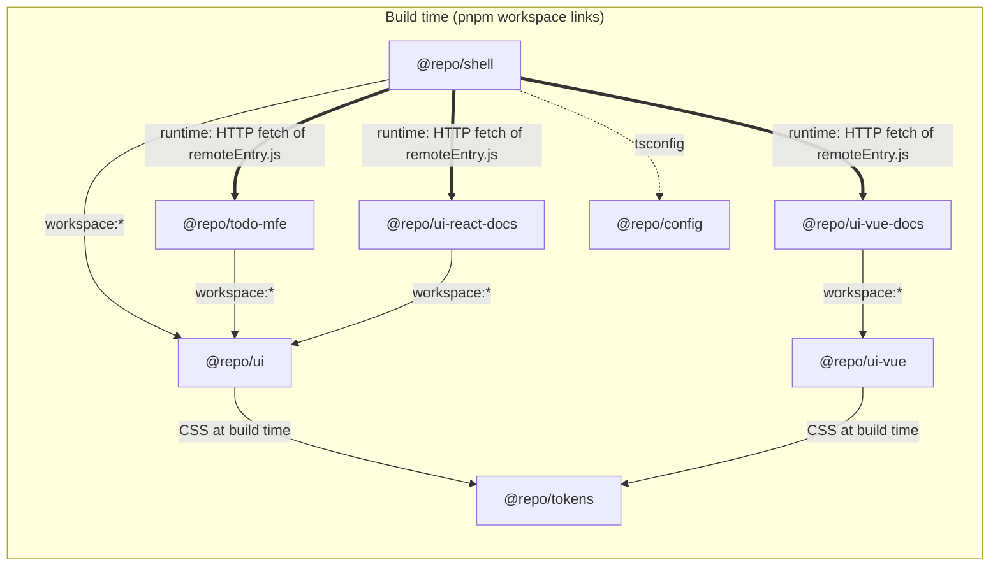
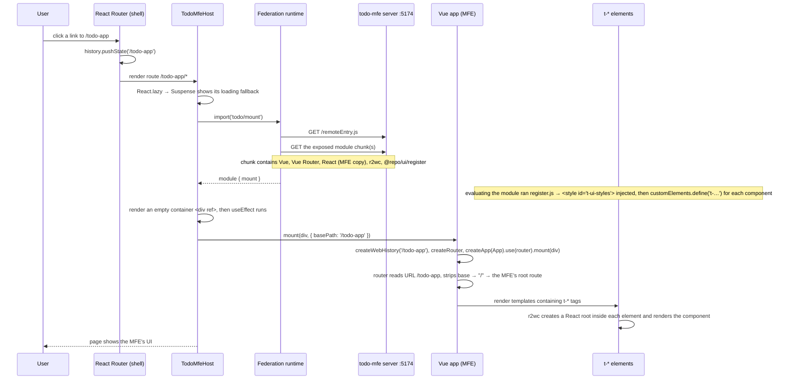

# How it all works together

This document follows one request from start to finish to show how the pieces cooperate.

**Contents**
1. [The pieces and how they depend on each other](#1-the-pieces-and-how-they-depend-on-each-other)
2. [Workspace and tooling layer](#2-workspace-and-tooling-layer)
3. [The UI package and its two entry points](#3-the-ui-package-and-its-two-entry-points)
4. [Runtime walkthrough: from `/` to the Vue app and back](#4-runtime-walkthrough-from--to-the-vue-app-and-back)
5. [Two routers, one URL](#5-two-routers-one-url)
6. [Two copies of React on one page](#6-two-copies-of-react-on-one-page)
7. [Development vs. production](#7-development-vs-production)
8. [Types across the boundaries](#8-types-across-the-boundaries)
9. [What happens when something is missing](#9-what-happens-when-something-is-missing)

For setup and commands, see the [README](../README.md).

---

## 1. The pieces and how they depend on each other

| Package | Role | Tech |
|---|---|---|
| `apps/shell` (`@repo/shell`) | Host app: owns the URL, the layout and the navigation. | React 19, React Router 8 |
| `apps/todo-mfe` (`@repo/todo-mfe`) | Remote app: built and served on its own, loaded by the shell at runtime. Uses `@repo/ui` as `t-*` custom elements, until it moves to `@repo/ui-vue`. | Vue 3, Vue Router 5 |
| `apps/ui-vue-docs` (`@repo/ui-vue-docs`) | Remote app, like the todo MFE: the Vue library's documentation, built on `@repo/ui-vue`. | Vue 3, Vue Router 5 |
| `apps/ui-react-docs` (`@repo/ui-react-docs`) | Remote app written in React: the React library's documentation, built on `@repo/ui`. | React 19 |
| `packages/tokens` (`@repo/tokens`) | Design tokens and the token → Tailwind theme. CSS only, no build. | CSS, Tailwind v4 |
| `packages/ui` (`@repo/ui`) | `T`-prefixed React components, usable from React directly and from any framework as `t-*` custom elements. | React, Radix, Tailwind v4 |
| `packages/ui-vue` (`@repo/ui-vue`) | The same components natively in Vue, with the same look. | Vue, Reka UI, Tailwind v4 |
| `packages/config` (`@repo/config`) | Shared tsconfig presets. | TypeScript 6 |

There are two kinds of dependency, and keeping them apart is the key to the architecture.



- **Build-time dependencies** are declared in `package.json`. pnpm links them through `node_modules`, and the bundler compiles them into the consumer's bundle. The apps depend on a component library this way, and the libraries (and the apps running Tailwind) on `@repo/tokens`. Every package also extends a `@repo/config` preset.
- **The runtime dependencies** (shell → each remote) are not in any `package.json`. The shell knows only a URL and a function signature per remote. Each remote is a separate deployable that the browser downloads when the user navigates to it. That's why the shell can be built, typechecked and deployed without the remotes existing, and the other way round.

## 2. Workspace and tooling layer

**pnpm workspaces.**
- `pnpm-workspace.yaml` declares `apps/*` and `packages/*` as workspace packages.
- `"@repo/ui": "workspace:*"` makes pnpm symlink `apps/*/node_modules/@repo/ui` → `packages/ui`.
- Third-party versions are defined once, in the `catalog:` block, and each package references them as `"catalog:"`.
- pnpm 12 also enforces two install policies:
  - `minimumReleaseAge`: no versions published less than 24 h ago;
  - `strictDepBuilds`: no unapproved install scripts.

**Turborepo task graph.**
- Root scripts call `turbo run <task>`. Turbo runs that script in every package that has it, in dependency order.

| Task | Definition (in `turbo.json`) | Consequence |
|---|---|---|
| `build` | `dependsOn: ["^build"]`, outputs `dist/**` | The libraries build before the apps; results are cached. |
| `typecheck` | `dependsOn: ["^build"]` | The apps typecheck against the libraries' emitted `.d.ts` files, so the libraries are built first. |
| `dev` | `dependsOn: ["^build"]`, persistent | The libraries are built once, then all the dev processes run together. |
| `dev` in each library | the library's `turbo.json` adds `dependsOn: ["build"]` | Its watcher starts after the initial build, so the two never write `dist/` at once. |
| `build` in each library | the library's `turbo.json` adds `$TURBO_ROOT$/packages/tokens/**` to `inputs` | `@repo/tokens` has no build task, so its files are listed as inputs: a token change invalidates the cache. |
| `preview` | `dependsOn: ["build"]`, persistent | Builds everything, then serves the production output. |

So `pnpm dev` resolves to this sequence:

```
@repo/ui#build ──────► @repo/ui#dev            (vite build --watch)
                  ├──► @repo/todo-mfe#dev      (vite on :5174)
                  ├──► @repo/ui-react-docs#dev (vite on :5176)
                  └──► @repo/shell#dev         (vite on :5173)
@repo/ui-vue#build ──► @repo/ui-vue#dev        (vite build --watch)
                  └──► @repo/ui-vue-docs#dev   (vite on :5175)
```

**TypeScript presets.**
- `packages/config/base.json` holds the strict, shared compiler options.
- `react.json`, `vue.json` and `node.json` add JSX and lib settings for each environment.
- Every package has a `tsconfig.json` for browser code in `src/` and a `tsconfig.node.json` for its `vite.config.ts`.
- The presets extend `./base.json` (inside the package), not a root file. Vite 8 resolves `extends` through the pnpm symlink path, where `../../` points somewhere else.

## 3. The UI package and its two entry points

```
packages/ui/src/T<Name>.tsx         the React components (Radix + Tailwind classes)
packages/ui/src/styles/tokens.css   design tokens (--t-* CSS variables)
packages/ui/src/styles/index.css    the library stylesheet: Tailwind utilities + tokens
packages/ui/src/index.ts            entry ".":          re-exports the components (and pulls in the stylesheet)
packages/ui/src/register.ts         entry "./register": injects the stylesheet, then
                                    customElements.define('t-…', r2wc(bridge(Component), …)) for each component
```

The tokens, the Tailwind setup and the component recipe are described in [design-system.md](design-system.md).

**Build.** `vite build` (library mode, ESM, with `@tailwindcss/vite`) plus `tsc --emitDeclarationOnly` produce:

```
dist/index.js      dist/index.d.ts      entry "."
dist/register.js   dist/register.d.ts   entry "./register" (the stylesheet is inlined in it as a string)
dist/styles.css                         the stylesheet as a file, export "./styles.css"
dist/*.js          dist/*.d.ts          chunks for code both entries share, and a .d.ts for every other module
```

React, react-dom and the other runtime dependencies (`@r2wc/*`, `@radix-ui/*`, `class-variance-authority`, `clsx`, `tailwind-merge`) are **external**: the library doesn't bundle them. Each consuming app bundles them, resolving the non-React ones from ui's own dependencies.

**Consumption.** `package.json#exports` maps `@repo/ui` → `dist/index.js` and `@repo/ui/register` → `dist/register.js`, each with its `.d.ts`. Apps therefore use the **built** files, which is why ui has to be built before the apps can start or typecheck (Turbo handles this).

| Consumer | Import | What it gets |
|---|---|---|
| shell (React) | `import { … } from '@repo/ui'` | The plain React components, rendered by the shell's own React. |
| shell (React) | `import '@repo/ui/styles.css'` (once, in `main.tsx`) | The stylesheet, bundled into the shell's CSS. |
| shell (React) | `@import '@repo/tokens/theme.css'` (in its own `src/index.css`) | The token theme for the shell's own Tailwind build, so its utilities resolve to the same tokens. |
| ui-vue-docs (Vue) | `import { … } from '@repo/ui-vue'`, and `@repo/ui-vue/styles.css` inside its own `src/styles.css` | The native Vue components; the stylesheet is injected inline by `mount.ts` while the app is mounted. |
| ui-react-docs (React) | `import { … } from '@repo/ui'`, and `@repo/ui/styles.css` inside its own `src/styles.css` | The React components, rendered by the remote's own React; the stylesheet is injected inline by `mount.tsx` while the app is mounted. |
| todo-mfe (Vue) | `import '@repo/ui/register'` | Side effects: the stylesheet is injected as `<style id="t-ui-styles">`, then the `t-*` custom elements are registered with the browser. |

`"sideEffects": ["./dist/register.js", "./dist/styles.css"]` tells bundlers that these bare imports must not be tree-shaken away, even though they export nothing.

**How the `t-*` custom elements work.**
- `r2wc(bridge(Component), { props })` returns a custom element class, which `register.ts` defines under a `t-*` tag (`T<Name>` → `<t-<name>>`). `bridge()` strips the `container` prop r2wc adds.
- When the browser inserts such an element into the page, the class creates a React root *inside that element* and renders the component into it, passing the element's props.
- Each declared prop is observed both as an attribute (`prop="…"`) and as a DOM property (`el.prop = …`). A change re-renders the React tree. Undeclared props never reach the component.
- Vue's compiler is told to leave `t-*` tags alone (`isCustomElement` in `apps/todo-mfe/vite.config.ts`). Otherwise it would try to resolve them as Vue components.
- The rules for props, booleans, events and content, and why the stylesheet is inlined, are in [react-components-in-vue.md](react-components-in-vue.md).

## 4. Runtime walkthrough: from `/` to the Vue app and back

### 4.1 Opening the shell

1. The browser loads `http://localhost:5173/`. The shell's `index.html` contains the federation **host init** script, which the plugin injected at build or serve time.
   - It starts the Module Federation runtime and registers one remote: `todo` → `VITE_TODO_REMOTE_URL` (default `http://localhost:5174/remoteEntry.js`).
   - Nothing is downloaded from the remote yet.
2. `main.tsx` renders `<StrictMode><BrowserRouter><App/></BrowserRouter></StrictMode>`.
3. React Router matches the URL and renders the shell's own route. Components the shell imports from `@repo/ui` render as ordinary React components, with ordinary React props and event handlers. They are styled by `@repo/ui/styles.css`, which `main.tsx` imports, so the shell's build puts it in a `<link>`ed CSS file.

### 4.2 Navigating to `/todo-app`



Details worth knowing:
- **Lazy loading:** `React.lazy` caches the module promise, so the remote is downloaded only once per page load. Later visits to `/todo-app` reuse it and only call `mount` again.
- **Ownership:** `TodoMfeHost` (built with `createRemoteHost`, like every remote's host) renders an empty container `<div>`, and React never renders children into it. Everything inside belongs to Vue, and everything inside each `t-*` element belongs to the MFE's React.
- **Styles:** the remote's stylesheet arrives inside the JavaScript chunk, not as a CSS file, so nothing depends on the federation runtime loading CSS.

### 4.3 Events from a custom element inside the MFE

```
<t-…>         ← Vue's @click listener is attached here
  <button>    ← a native element the component renders; the user clicks here and "click" bubbles up
```

- The elements use light DOM (no shadow root), so a native event such as `click` from inside the component bubbles to the `t-*` element, where Vue's `@click` handler runs.
- Because the listener sits on the host, a disabled component relies on the native `disabled` attribute (which suppresses the click entirely), never on `pointer-events: none` (which would let the click land on the host).
- No r2wc event mapping is involved. r2wc's `events` option would dispatch an extra `CustomEvent` named after the prop (`onClick` → `click`), so the handler would fire twice. Reserve `events` for non-native events (`onSelect` → `select`).

### 4.4 Leaving `/todo-app`

1. React Router calls `pushState` with a shell route and renders it instead of `TodoMfeHost`.
2. React runs the effect cleanup, which is the function `mount` returned:
   - `app.unmount()`: Vue removes its DOM. Removing each `t-*` element triggers its `disconnectedCallback`, which unmounts the React root inside it.
   - `history.destroy()`: removes Vue Router's `popstate` listener from `window`. `app.unmount()` alone does not.
3. Nothing from the MFE is left in the page body or on `window`. The one trace is the injected `<style id="t-ui-styles">` in `<head>`: it matches the shell's own stylesheet and is reused on the next visit. The downloaded module stays cached too.

This was verified by counting `popstate` listeners on `window`: 1 on a shell route (React Router), 2 while the MFE is mounted, back to 1 after leaving, over repeated round trips.

### 4.5 StrictMode, refreshes, back/forward

- **StrictMode (dev only):** React mounts, unmounts and re-mounts every effect once, so `mount` → unmount → `mount` happens immediately. The cleanup is complete, so exactly one Vue app remains.
- **Hard refresh on `/todo-app`:** the Vite dev server and `vite preview` both serve `index.html` for unknown paths (SPA fallback). The shell boots directly on `/todo-app` and goes straight into step 4.2.
- **Back/forward:** the browser fires `popstate`. React Router re-renders the matching route, so the MFE is mounted or unmounted exactly as with link clicks.

## 5. Two routers, one URL

The page has a single `window.history`, used by two routers:

| URL | Shell (React Router) sees | MFE (Vue Router, base `/todo-app`) sees |
|---|---|---|
| `/` (or any other shell route) | the matching shell route | not mounted |
| `/todo-app` | route `/todo-app/*` → `TodoMfeHost` | `/` (the MFE's root route) |
| `/todo-app/anything` | still `/todo-app/*` (splat) | `/anything` (resolved by the MFE's own routes) |

- The shell owns the first path segment and hands everything under `/todo-app` to the MFE.
- The splat (`/*`) means the shell keeps the MFE mounted while its internal URL changes, so the MFE can add routes without touching the shell.
- `basePath` is the only routing information that crosses the boundary. The shell defines it once (`TODO_BASE_PATH`) and passes it to `mount`.
- When the MFE runs standalone, `main.ts` passes `basePath: '/'`.

## 6. Two copies of React on one page

Whenever a remote that uses React is mounted, two independent copies of React are loaded:

1. **The shell's React** renders the layout, the nav and the remote's host component.
2. **The remote's React**, bundled into its chunk, renders only inside the remote: into its own root (a React remote), or inside the `t-*` custom elements (the todo MFE).

This works because each copy manages its own roots and never touches the other's DOM. The cost is download size: each such remote carries a full extra copy of React and react-dom.

The design system's stylesheet is on the page twice for the same reason: the shell's `styles.css`, and the copy the remote injects. With the same ui version on both sides the two are identical. With different versions, the remote's copy wins where they differ, because it comes later (see [react-components-in-vue.md](react-components-in-vue.md#5-styles-across-the-boundary)).

The fix is federation `shared` (React as a singleton provided by the shell). It's deliberately not enabled yet, and it brings one catch: a remote's `root.unmount()` (a React remote's unmount, or the custom element's) would then run on the *same* React instance while the shell is in the middle of its commit, which React warns about. Those unmounts would need deferring (e.g. `queueMicrotask`).

## 7. Development vs. production

| | `pnpm dev` | `pnpm build` + `pnpm preview` (or a real deploy) |
|---|---|---|
| **todo-mfe** | Vite dev server on :5174 serves `remoteEntry.js` and unbundled modules (`/@id/virtual:mf-exposes…`, `/node_modules/.vite/deps/…`). `server.origin` makes those URLs absolute so they resolve from the shell's page. | `dist/remoteEntry.js` + `dist/assets/*`, served from any static host. Chunks are resolved relative to the remote entry's URL. |
| **shell** | Vite dev server on :5173; remote URL taken from env at startup. | `dist/` with the remote URL **baked in** at build time. |
| **@repo/ui** | `vite build --watch` rewrites `dist/` on change, and both apps reload with the new code. A new Tailwind class in a component also regenerates `styles.css` and the CSS inlined in `register.js`. | Built once, before the apps. |
| **Cross-origin** | Vite's default CORS allows any `localhost` origin. | The remote's host must allow the shell's origin (CORS) for the module scripts. |

Changing where the remote lives in production means rebuilding the shell with `VITE_TODO_REMOTE_URL=<url>`. Turbo includes that variable in the shell build's cache key, so a different value produces a fresh build.

## 8. Types across the boundaries

| Boundary | How types flow |
|---|---|
| ui → apps | `tsc` emits `.d.ts` files into `packages/ui/dist`, and `exports` points `types` at them. `@repo/ui/register` has an empty declaration (`export {}`): it's a side-effect import. Inside ui, `src/env.d.ts` loads Vite's types so the `.css` and `?inline` imports typecheck. |
| MFE → shell | Nothing is generated. `apps/shell/src/remotes.d.ts` declares the module `todo/mount` by hand, mirroring `apps/todo-mfe/src/mount.ts`. Keep them in sync. Federation's automatic type generation is off (`dts: false`). |
| `.vue` files | `vue-tsc` typechecks them. That's why the repo uses TypeScript 6: TypeScript 7 removed the compiler API `vue-tsc` builds on. |

## 9. What happens when something is missing

| Situation | Result |
|---|---|
| The todo-mfe server is down or the URL is wrong | `import('todo/mount')` rejects (federation error `RUNTIME-008`). The error boundary shows its fallback, and the rest of the shell keeps working. Because `React.lazy` caches the failure, a reload is needed after the remote comes back. |
| Port 5173 or 5174 is already in use | The dev or preview server exits (`strictPort`) instead of silently moving to another port, which would break the hard-coded remote URL. |
| `@repo/ui` isn't built | The apps can't resolve `@repo/ui` (its `exports` point into `dist/`). Running through `pnpm dev`, `build` or `typecheck` avoids this because Turbo builds ui first. |
| A running dev server reports that a `@repo/ui` subpath "is not exported" | ui's `package.json` `exports` changed after the server started, and Vite still uses the old copy it read. Restart `pnpm dev`. The ui watcher doesn't reload its own `vite.config.ts` either. |
| The MFE's components render unstyled | `@repo/ui/register` wasn't imported. It is what injects the stylesheet, so a `t-*` element defined some other way has no styles. |
| A dependency was published less than 24 h ago | pnpm refuses it (`minimumReleaseAge`) and picks an older version within the range, or fails if none fits. |
